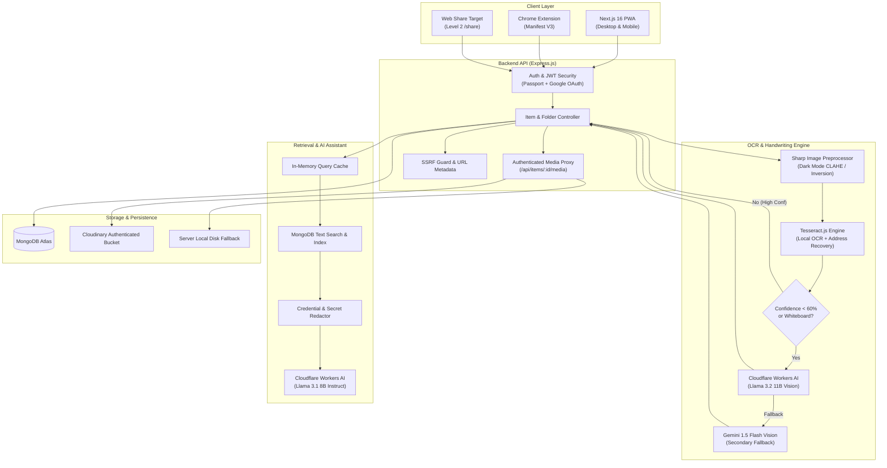

# Holder — Intelligent Multi-Modal Information Vault & Search Engine

Holder is a high-performance personal information vault, knowledge retrieval engine, and intelligent screenshot capture platform. It unifies notes, web bookmarks, screenshots, PDFs, and YouTube tutorials into a searchable, organized repository with automated OCR, handwriting recognition (HTR), and a retrieval-augmented AI assistant.

Built with **Next.js 16 (Turbopack)**, an **Express.js API**, **MongoDB Atlas**, **Tesseract OCR**, **Cloudflare Workers AI**, and **Google Gemini 1.5 Flash**.

---

## Architecture Overview



---

## Core Features & Capabilities

### 1. Multi-Modal Vault Ingestion
- **Instant Clipboard Paste**: Global `Ctrl+V` listener captures screenshots directly from your clipboard into the vault with instant client-side canvas compression (<400KB in ~30ms).
- **YouTube Media Ingestion**: Automatically extracts YouTube video metadata, channels, duration, video IDs, and high-res thumbnails (`https://img.youtube.com/vi/...`).
- **Web Bookmarks & Smart Scraper**: Fetches OpenGraph titles, descriptions, and favicons with built-in SSRF protection against private IP ranges.
- **PDF Documents**: Upload and view PDFs up to 25 MB with inline page rendering and text extraction.
- **Progressive Web App (PWA) & Web Share Target**: PWA with offline caching and Web Share Target Level 2 (`/share` route) to save screenshots and links from mobile share sheets.
- **Chrome Extension (Manifest V3)**: 1-click browser extension to save current tab URLs, highlight text snippets, and capture screenshots into folders.

### 2. Multi-Stage OCR & Handwriting (Vision HTR) Pipeline
- **Dark Mode Adaptive Preprocessing**:
  - Automatically calculates average luminance (`meanLum < 128`).
  - Applies color negative inversion (`.negate({ alpha: false })`), dynamic range normalization, and CLAHE (Contrast Limited Adaptive Histogram Equalization) to render dark-mode code snippets and low-contrast UI text razor-sharp for Tesseract.
- **Smart Address-Bar URL Recovery**:
  - Regex-based URL extraction with fuzzy address-bar domain matching and TLD corruption correction (`.c0m`, `.corn`, `.ong` -> `.com`, `.org`).
  - Dictionary noise rejection to prevent CLI commands (`npx`, `@latest`) and tech jargon (`devcon`, `silicon`) from triggering false-positive URLs.
- **Automatic Low-Confidence Handwriting Fallback (HTR)**:
  - If Tesseract's confidence score drops below 60% or symbol noise exceeds 65% (typical of whiteboards, handwritten notes, and math lectures), the pipeline automatically triggers the Vision HTR model.
  - Powered by **Cloudflare Workers AI** (`@cf/meta/llama-3.2-11b-vision-instruct`, `@cf/llava-hf/llava-1.5-7b-hf`) and **Google Gemini 1.5 Flash Vision**.
  - Automatically outputs clean LaTeX mathematical formulas ($M(t) = H(t) * M'(t)$) and structured block diagrams.
  - Manual **"Scan Handwriting"** button with live engine badges in the image inspection modal.

### 3. Retrieval-Augmented AI Assistant
- **Contextual Vault Q&A**: Asks questions across all saved notes, links, and OCR extracted texts with exact source attribution.
- **Strict Privacy & Secret Redaction**:
  - Private folders and sensitive items (`isPrivate: true`) are strictly excluded from AI prompt context.
  - Automatically redacts API keys, passwords, JWT tokens, and private SSH/RSA keys prior to dispatching prompts to AI models.
  - In-memory query caching and indexed text retrieval ensure sub-second response times.

### 4. Enterprise Security & Media Privacy
- **Authenticated Media Delivery**: Uploaded images and PDFs are stored in authenticated Cloudinary storage (or server disk) and served strictly through `/api/items/:id/media`. Direct storage IDs and raw URLs are never leaked to the public browser client.
- **SSRF Protection**: Resolves website domains and rejects non-global, local loopback, and reserved private IP ranges (`127.0.0.1`, `10.0.0.0/8`, `192.168.0.0/16`, `169.254.0.0/16`, `::1`).
- **Resilient Authentication**: Dual Google OAuth 2.0 and JWT token authentication with automated 32-byte cryptographic fallback derivation to guarantee zero-crash server startups on cloud platforms like Render.
- **IPv6-Safe Rate Limiting**: All user actions and assistant endpoints use IPv6-normalized key generators (`ipKeyGenerator`) to prevent rate-limit bypasses.

---

## Tech Stack

| Layer | Technology | Purpose |
| :--- | :--- | :--- |
| **Frontend** | Next.js 16.3.8, React 19 | App Router, Turbopack, SSR, Static Generation |
| **Styling** | Vanilla CSS, Lucide React | Solid dark mode (`#0b0f19`), glassmorphic panels, zero emojis |
| **Backend** | Node.js, Express.js 4 | REST API, streaming proxy, rate limiting, security middleware |
| **Database** | MongoDB Atlas, Mongoose 8 | Multi-tenant user schema, compound indexes, text search |
| **Image Processing** | Sharp, Tesseract.js 7 | Grayscale, CLAHE, lanczos3 scaling, local OCR worker |
| **Vision & AI** | Cloudflare Workers AI | Llama 3.2 11B Vision Instruct, Llama 3.1 8B Instruct |
| **Fallback Vision** | Google Gemini 1.5 Flash | Handwriting recognition and multimodal visual transcription |
| **Storage** | Cloudinary / Local Disk | Authenticated media storage with signed token access |
| **Extension** | Chrome Manifest V3 | Browser side-panel, background service worker, tab capture |
| **Deployment** | Vercel (Client), Render (API) | Cloud-hosted with zero-downtime rolling deployments |

---

## Directory Structure

```text
Holder/
├── client/                     # Next.js 16 Web Application
│   ├── app/                    # App Router (page.jsx, layout.jsx, share/page.jsx)
│   ├── components/             # ItemCard, ImageModal, AIAssistantDrawer, AddItemModal
│   ├── utils/                  # usePrivateMediaUrl, api helpers
│   ├── public/                 # PWA icons, manifest, service worker
│   └── vercel.json             # Vercel deployment configuration
├── server/                     # Express.js REST API
│   ├── config/                 # Security, Passport OAuth, Cloudinary configs
│   ├── controllers/            # Item, folder, assistant, metadata, auth controllers
│   ├── models/                 # Mongoose schemas (User, Item, Folder, PendingUpload)
│   ├── routes/                 # Express API routes
│   ├── services/               # OCR, Vision HTR, Cloudflare AI, item serializers
│   ├── scripts/                # Cloudinary authenticated migration scripts
│   └── tests/                  # Node.js native unit tests (security, AI service)
├── extension/                  # Chrome Extension (Manifest V3)
│   ├── manifest.json           # Extension permissions and scripts
│   ├── popup.html / popup.js   # Extension quick-save interface
│   └── content.js              # Page content and selection extractor
├── package.json                # Root monorepo workspace orchestration
└── README.md                   # Project documentation
```

---

## API Endpoints Reference

### Authentication
- `POST /api/auth/register` — Create local email/password account
- `POST /api/auth/login` — Sign in and receive 12-hour JWT
- `GET /api/auth/google` — Initiate Google OAuth 2.0 flow
- `GET /api/auth/me` — Retrieve signed-in user profile

### Vault Items & Media
- `GET /api/items` — Fetch user's vault items (supports filtering by folder, type, favorite, search)
- `POST /api/items` — Save new link, note, or document
- `PUT /api/items/:id` — Update item content, tags, or folder
- `DELETE /api/items/:id` — Delete vault item and revoke associated storage
- `POST /api/items/upload-image` — Upload screenshot/image with automated OCR
- `POST /api/items/upload-pdf` — Upload PDF with page extraction
- `GET /api/items/:id/media` — Authenticated streaming proxy for private images/PDFs
- `POST /api/items/:id/transcribe-vision` — Trigger deep Vision HTR scan for handwriting/whiteboards

### AI Assistant & Metadata
- `POST /api/assistant/ask` — Ask questions to Cloudflare Workers AI with vault context
- `GET /api/metadata/fetch-url?url=...` — Safely scrape metadata from public web URLs

---

## Local Setup & Development

### 1. Backend Server Setup
```powershell
cd server
Copy-Item .env.example .env
```
Populate `.env` with your keys:
```env
PORT=5000
NODE_ENV=development
MONGO_URI=mongodb+srv://<username>:<password>@cluster0.mongodb.net/holder_db
JWT_SECRET=<generate-at-least-32-random-bytes>

# Storage (Cloudinary)
CLOUDINARY_URL=cloudinary://<api_key>:<api_secret>@<cloud_name>

# Vision AI & Assistant (Cloudflare Workers AI)
CLOUDFLARE_ACCOUNT_ID=<your_cloudflare_account_id>
CLOUDFLARE_API_TOKEN=<your_cloudflare_api_token>

# Secondary Vision Fallback (Optional)
GEMINI_API_KEY=<your_gemini_api_key>
```
Install dependencies and run:
```powershell
npm install
npm start
```
Run tests:
```powershell
npm test
```

### 2. Frontend Client Setup
```powershell
cd ../client
Copy-Item .env.example .env.local
```
Set `NEXT_PUBLIC_API_URL=http://localhost:5000/api` in `.env.local`.
```powershell
npm install
npm run dev
```
Open [http://localhost:3000](http://localhost:3000) in your browser.

### 3. Chrome Extension
1. Open Google Chrome and navigate to `chrome://extensions/`.
2. Enable **Developer mode** in the top-right corner.
3. Click **Load unpacked** and select the `extension/` folder.

---

## Deployment Guidelines

- **Frontend (Vercel)**: Configured via root `vercel.json` pointing to `client/.next` and `npm --prefix client run build`.
- **Backend (Render)**: Set Root Directory to `server`, Build Command to `npm install`, and Start Command to `npm start`. Ensure `0.0.0.0` port binding is active.
